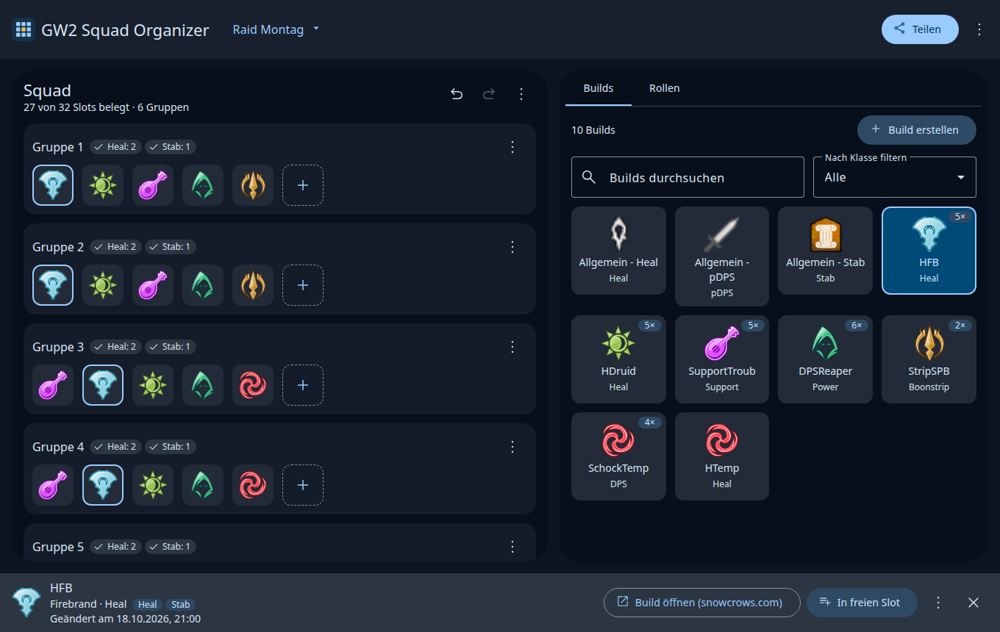

# GW2 Squad Organizer (Web)

Web-App zum Planen von WvW-Squads in Guild Wars 2: bis zu 15 Gruppen mit je bis zu 10 Slots, eine Build-Bibliothek mit Elite-Spezialisierungen und Build-Links, eine Rollen-Übersicht und Teilen per Link. Die App läuft als installierbare PWA auch offline. Alle Daten bleiben im Browser.

Sie ist die Web-Fassung des [GW2 Squad Organizer für Desktop](https://github.com/Kell-Kaychup/GW2_Squad_Organizer) (Python/Tkinter). JSON-Dateien lassen sich zwischen beiden Versionen austauschen.



## Funktionen

Aus der Desktop-App übernommen:

- Squad mit 1 bis 15 Gruppen und 1 bis 10 Slots pro Gruppe
- Builds anlegen, ändern und löschen (Klasse, Elite-Spezialisierung, Rolle, Link)
- Ziehen und Ablegen: aus der Bibliothek in einen Slot, zwischen Slots tauschen, aus dem Squad herausziehen entfernt den Build
- Export und Import als JSON im Format der Desktop-App
- „Post erstellen“: Beitragstext für Discord mit Anzahl pro Build und ein PNG der Aufstellung
- Hervorhebung aller Slots, die den ausgewählten Build enthalten

Neu in der Web-Fassung:

- Mehrere Squads speichern, umbenennen, duplizieren und wechseln
- Teilen per Link: Squad und verwendete Builds stecken komprimiert im URL-Fragment (`#s=…`). Das Fragment erreicht keinen Server.
- Rollen-Übersicht: Aufgaben wie Heal, Stab, Quickness oder Boonstrip werden pro Gruppe und für den ganzen Squad gezählt. Fehlt eine geprüfte Aufgabe in einer belegten Gruppe, steht das direkt an der Gruppe.
- Rückgängig und Wiederholen für alle Änderungen
- Automatisches Speichern in IndexedDB, Abgleich zwischen mehreren offenen Tabs
- Deutsch und Englisch, helles und dunkles Design
- Bedienung per Tastatur, Touch und Screenreader

Nicht übernommen wurde „Get External Builds“. Die Desktop-App liest dafür die Seiten von SnowCrows und MetaBattle aus. Ein Browser darf diese Seiten wegen CORS nicht direkt abrufen, dafür bräuchte es einen eigenen Server oder einen regelmäßigen Abruf beim Build. Die lokale „DB“ der Desktop-App ist in der Web-Fassung die Build-Bibliothek selbst, sie wird automatisch gespeichert.

## Bedienung

Jede Funktion ist ohne Ziehen erreichbar. Ein Build in der Bibliothek wird ausgewählt, danach platziert jeder angetippte Slot diesen Build. Ein belegter Slot wird ausgewählt und dann mit einem anderen Slot getauscht. Ein leerer Slot ohne Auswahl öffnet eine Build-Auswahl. Auf dem Handy ist das der übliche Weg; Slots lassen sich dort nach kurzem Gedrückthalten auch ziehen.

| Taste                          | Wirkung                         |
| ------------------------------ | ------------------------------- |
| Strg + Z / Strg + Umschalt + Z | Rückgängig / Wiederholen        |
| Pfeiltasten, Pos1, Ende        | Slot wechseln                   |
| Enter oder Leertaste           | auswählen, platzieren, tauschen |
| Entf                           | ausgewählten Slot leeren        |
| Esc                            | Auswahl aufheben                |

Vor dem Öffnen eines Build-Links zeigt die App die Zieladresse an. Gespeichert werden nur Links mit `http://` oder `https://`.

## Entwicklung

Voraussetzung ist Node.js 24 oder neuer.

```bash
npm install
npm start            # Entwicklungsserver auf http://localhost:4200/
npm test             # Unit-Tests (Vitest)
npm run e2e          # End-to-End- und Barrierefreiheitstests (Playwright, axe-core)
npm run build        # Produktions-Build nach dist/gw2-squad-organizer/browser
```

Für `npm run e2e` braucht Playwright einen Chromium-Browser (`npx playwright install chromium`). Ein vorhandenes Chromium lässt sich über die Umgebungsvariable `PW_CHROMIUM_PATH` angeben.

Der Service Worker ist nur im Produktions-Build aktiv. Zum Testen der Offline-Funktion den Inhalt von `dist/gw2-squad-organizer/browser` mit einem statischen Server ausliefern.

### Aufbau

| Ordner                                                    | Inhalt                                                                                                          |
| --------------------------------------------------------- | --------------------------------------------------------------------------------------------------------------- |
| `src/app/domain`                                          | Fachlogik ohne Angular: Squad-Operationen, JSON-Format der Desktop-App, Teilen-Codec, Rollen-Zählung, Post-Text |
| `src/app/state`                                           | Signal-Store mit Undo/Redo und Speicherung, Auswahl, Layout, Bedienlogik (`actions.ts`)                         |
| `src/app/squad`, `library`, `roles`, `selection`, `shell` | Oberfläche                                                                                                      |
| `src/app/dialogs`, `src/app/post`                         | Dialoge, sie werden erst bei Bedarf geladen                                                                     |
| `src/app/i18n`                                            | Texte auf Deutsch und Englisch                                                                                  |
| `src/styles`                                              | Material-3-Palette (aus den Farben der Desktop-App erzeugt) und Design-Tokens                                   |
| `public/icons/classes`                                    | Klassen- und Rollen-Icons aus der Desktop-App                                                                   |
| `e2e`                                                     | Playwright-Tests                                                                                                |

Die Oberfläche folgt Material 3 (Angular Material) mit den Regeln der Designsprache „Unified Glass & Material“: Trefferflächen ab 48 × 48 px, Kontrast nach WCAG 2.2 AA, Status nie nur über Farbe, Rücksicht auf „Bewegung reduzieren“. Die E2E-Tests prüfen das mit axe-core in hellem und dunklem Design.

Die UI-Icons stammen aus `@material-symbols/svg-400` und sind als SVG eingebettet. Nach einer Änderung der Liste in `scripts/sync-icons.mjs` erzeugt `npm run icons` die Datei `src/app/ui/icons.generated.ts` neu.

## Veröffentlichung auf GitHub Pages

Der Workflow `.github/workflows/ci.yml` führt bei jedem Push und Pull Request die Tests aus. Auf `main` baut er die App mit dem Repository-Namen als Unterpfad und veröffentlicht sie auf GitHub Pages. Dafür muss im Repository unter Settings → Pages als Quelle „GitHub Actions“ eingestellt sein. Die App ist danach unter `https://<benutzer>.github.io/<repository>/` erreichbar.

Lokal entspricht das `REPO_NAME=<repository> npm run build:pages`.

## Rechtliches

Guild Wars 2 sowie die Klassen- und Spezialisierungs-Icons sind Marken bzw. Eigentum von ArenaNet, LLC und NCSOFT. Dieses Fan-Projekt steht in keiner Verbindung zu ArenaNet. Die UI-Icons (Material Symbols) stehen unter der Apache-Lizenz 2.0.
